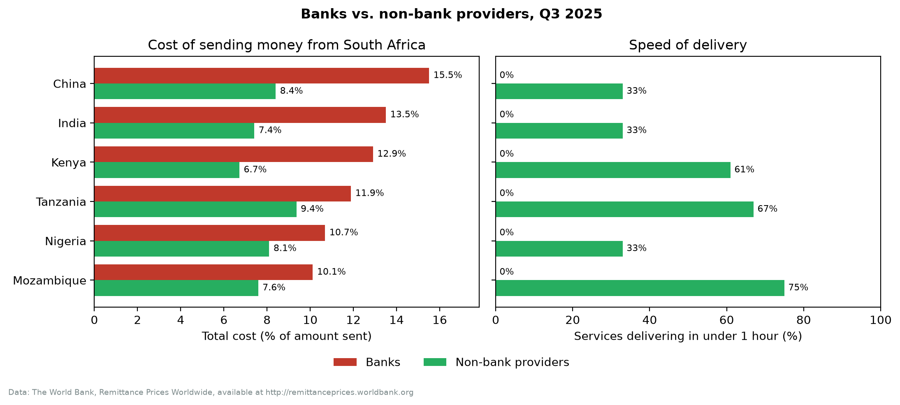

# What banks charge to move money out of South Africa

**Question:** How do banks compare with non-bank providers on the cost and speed of cross-border payments from South Africa?

## Key findings
- **Banks cost more in every corridor:** 10–16% of the amount sent, versus 7–9% for non-bank providers, a gap of 2.5 to 7.1 percentage points.
- **No bank service settles within an hour, in any corridor.** Between 33% and 75% of non-bank services do.
- **Supplier payments to Asia cost the most:** China (15.5%) and India (13.5%) are the most expensive bank routes in the sample.
- **For a business sending $10,000 a month,** bank fees come to about $12,100–18,600 a year per corridor. A service 40% cheaper would save about $4,900–7,400.



## Results (Q3 2025)

| Corridor | Banks tracked | Bank cost | Non-bank cost | Bank cost per year ($10k/month) | Saving at 40% cheaper |
|---|---|---|---|---|---|
| China | 3 | 15.5% | 8.4% | $18,608 | $7,443 |
| India | 1 | 13.5% | 7.4% | $16,212 | $6,485 |
| Kenya | 1 | 12.9% | 6.7% | $15,492 | $6,197 |
| Tanzania | 1 | 11.9% | 9.4% | $14,268 | $5,707 |
| Nigeria | 2 | 10.7% | 8.1% | $12,828 | $5,131 |
| Mozambique | 2 | 10.1% | 7.6% | $12,141 | $4,856 |

## Method
1. Filtered the World Bank Remittance Prices Worldwide dataset to transfers from South Africa in Q3 2025.
2. Used the total cost of sending the larger amount tracked (about $500), including fees and exchange rate margin.
3. Averaged each provider's products first, so firms with many products don't dominate.
4. Counted only firms of type "Bank" as banks; hybrid "bank via transfer company" services were counted as non-banks.
5. Measured speed as the share of services delivering in under one hour.

## Limitations
- The data covers small consumer transfers, not large B2B payments. Business rates are lower in percentage terms, so dollar figures are illustrative.
- Malawi was excluded: a gap between official and market exchange rates makes costs incomparable.
- India, Kenya, and Tanzania have only one bank in the sample.

## Files
- `report.pdf`: one-page report
- `analysis.ipynb`: analysis code
- `corridor_summary.csv`: results table
- `corridor_costs.png`: chart

## Reproduce
1. Download the dataset from the "Data Download" page at remittanceprices.worldbank.org and save it as `rpw.xlsx` in this folder.
2. Run:
   ```
   uv sync
   ```
3. Run `analysis.ipynb`.

## Data source
The World Bank, Remittance Prices Worldwide, available at http://remittanceprices.worldbank.org. This project is not endorsed by the World Bank.

## Author
Yeab Getu · [LinkedIn](https://linkedin.com/in/yeab-getu-963394214)
