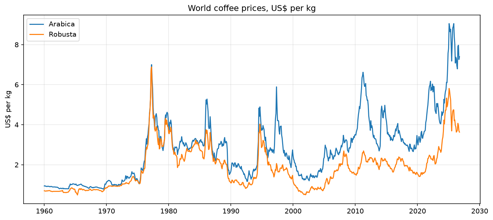
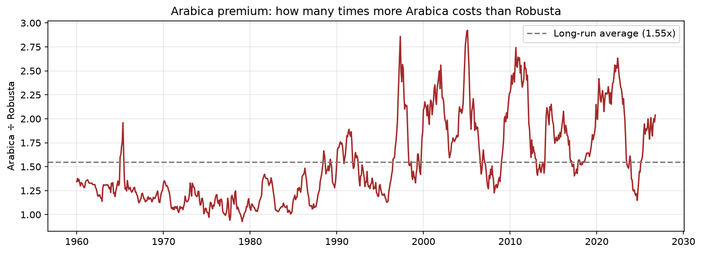
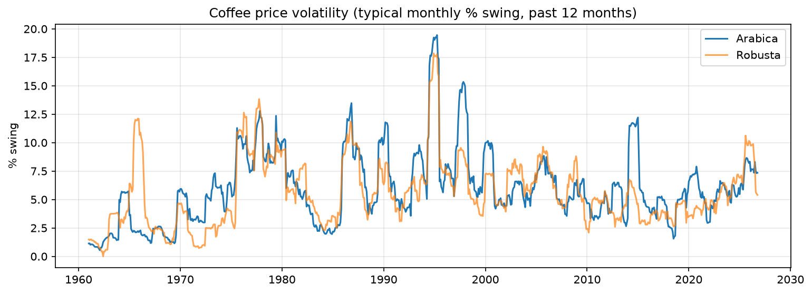
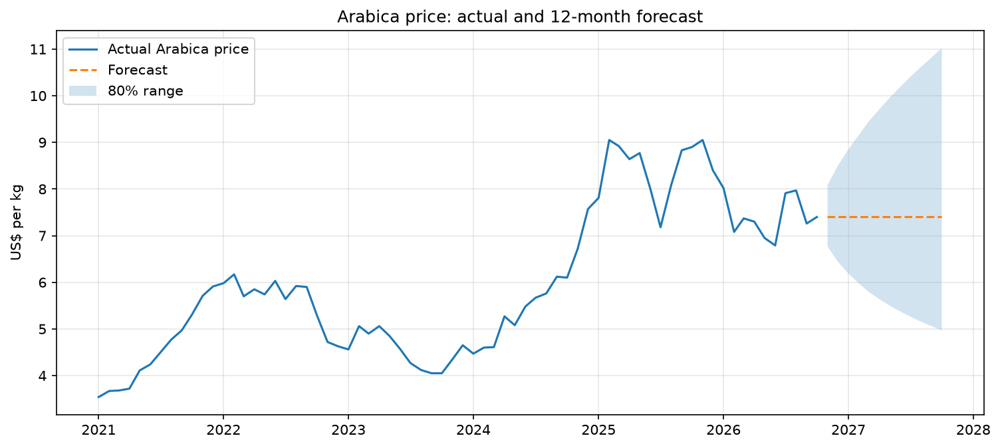

# ☕ Coffee Price Risk: What the Arabica Boom Means for Ethiopia

**Python · pandas · statsmodels · matplotlib · uv**

> **Headline:** If export volumes hold steady, world Arabica price swings alone could move Ethiopia's yearly coffee export revenue anywhere from about **$2.0 billion to $4.5 billion** by late 2027, compared with about $3.0 billion today.

## Question

How unusual are today's coffee prices, how risky are they, and what could price swings mean for Ethiopia's coffee export revenue?

## Why It Matters

Ethiopia grows only Arabica coffee, and coffee is one of the country's largest sources of foreign currency. When world Arabica prices move, Ethiopia's export earnings move with them. This project uses 66 years of World Bank monthly price data (1960–2026) to put the recent price boom in context and measure the risk it creates.

## Key Findings

1. **Record nominal prices.** Arabica reached about $9/kg in 2025 and was still $7.40/kg in October 2026. Robusta fell further, to $3.63/kg.
2. **An above-normal Arabica premium.** Arabica costs 2.04x Robusta, above its post-1990 average of 1.82x and higher than 69% of months since 1990. In 2024 the premium nearly vanished (≈1.2x) before recovering.
3. **Two market eras.** The premium was stable (1.0–1.4x) under the International Coffee Agreement quota system until 1989, and volatile (1.2–2.9x) since. Comparing today with the full 66-year average would be misleading.
4. **High prices, not chaos.** Recent Arabica volatility (7.3% typical monthly swing) is only slightly above its post-1990 average (6.6%) and far below the 1990s peak (~19%). At current prices, a typical month still moves about ±$0.54/kg.
5. **Prices can't be reliably forecast.** An ARIMA model did not beat a simple "no change" forecast in a 12-month backtest (19.0% vs 17.8% average error), consistent with commodity prices behaving close to a random walk. The useful output is the uncertainty range.
6. **What it means for Ethiopia.** The 80% range for Arabica in October 2027 is $4.97–$11.02/kg. If volumes hold steady, that implies yearly export revenue between about $2.0 billion and $4.5 billion.

## Charts

### World coffee prices, 1960–2026

Arabica hit a record nominal high in 2025, while Robusta has fallen back faster.

### The Arabica premium

Stable until the quota system ended in 1989, volatile since. Today's 2.04x is above the modern average but not extreme.

### Price volatility

Today's market is expensive, but not unusually volatile. The 1990s were far wilder.

### 12-month forecast

The forecast line is flat because past prices give little reliable signal about future moves. The shaded 80% range is the real result.

## Method

1. **Cleaning:** extracted monthly Arabica and Robusta prices from the World Bank file into a tidy table.
2. **Premium:** calculated Arabica ÷ Robusta each month and compared today with the post-1990 era.
3. **Volatility:** measured the 12-month rolling standard deviation of monthly % price changes, by decade.
4. **Forecast:** fit ARIMA(1,1,1) on log prices (1990 onward), backtested it on the last 12 months against a "no change" benchmark, then forecast 12 months ahead with an 80% range.
5. **Scenario:** applied the forecast range to Ethiopia's 2025/26 exports (~400,000 tonnes at ~$7,500/tonne).

## Limitations

- **Prices are nominal**, not adjusted for inflation. In real terms, the 1977 spike was larger than today's.
- **The revenue scenario is simplified.** It assumes Ethiopian export prices move by the same percentage as world Arabica and that volumes stay constant. In reality, Ethiopian specialty coffee prices may not move one-for-one with world prices.
- **Export figures** (~$3 billion, ~$7,500/tonne in 2025/26) are Ethiopian Coffee and Tea Authority figures as reported in the news

## Project Structure

```
ethiopia-coffee-premium/
├── data/
│   ├── raw/          # World Bank file, unedited
│   └── processed/    # cleaned monthly prices
├── images/           # charts used in this README
├── notebooks/
│   └── 01_coffee_prices.ipynb
├── get_data.py       # downloads the World Bank data
├── pyproject.toml    # project dependencies
└── uv.lock           # exact package versions
```

## How to Run

Requires [uv](https://docs.astral.sh/uv/).

```
cd ethiopia-coffee-premium
uv sync
uv run get_data.py
```

Then open `notebooks/01_coffee_prices.ipynb` and click **Run All**.

## Data Source

World Bank Commodity Price Data (The Pink Sheet), monthly prices, licensed CC BY 4.0.

---

**Yeab Getu** · Data Analyst · [LinkedIn](https://linkedin.com/in/yeab-getu-963394214) · yeabgetuu@gmail.com
